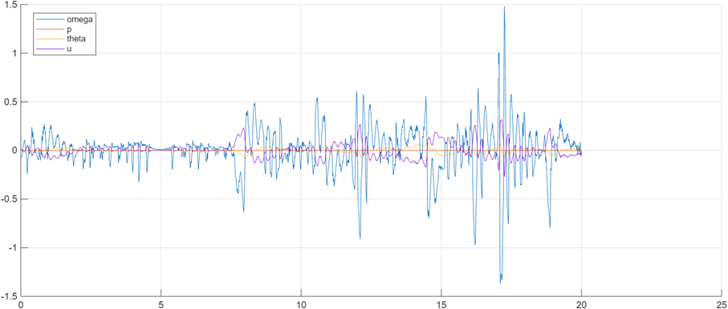

# Self-Stabilizing Inverted Pendulum Robot (Segway)

**Nonlinear Modeling, Luenberger State Observation, LQR / Pole Placement Control & 200 Hz Embedded Deployment**

Developed as part of the Mechatronics & Control Engineering project (TRO25-GR6) at **Mines Paris -- PSL**.

> **Team & Scope Note:** Mechanical CAD design and 3D-printed chassis manufacturing were completed by teammates within our engineering project group. This repository focuses on **control engineering, state estimation, MATLAB/Simulink modeling, motor system identification, and real-time embedded firmware**.

---

## Overview

A two-wheeled Segway-type robot is a naturally unstable, underactuated inverted pendulum. This project implements the complete control pipeline from first-principles physics to real-time stabilization on hardware:

1. **Modeling & Model-Order Reduction:** Coupled nonlinear equations of motion linearized around the unstable vertical equilibrium ($\theta = 0$), with **singular perturbation reduction** eliminating fast motor electrical dynamics ($L/R \sim \text{ms}$ vs. mechanical timescales $\sim 100\text{ ms}$).
2. **System Identification:** On-board 6-regime excitation generator (step, square, sine, sawtooth, 0.2--3.0 Hz chirp, and 16-bit LFSR PRBS) paired with continuous-time 2nd-order transfer function estimation (`tfest`) in MATLAB.
3. **State Observation:** 3-state **Luenberger observer** fusing wheel encoder angles and IMU measurements (gyroscope + accelerometer) to reconstruct the unmeasured pitch angle $\theta$ (full-rank observability $\mathrm{rank}(\mathcal{O}) = 3$).
4. **State-Feedback Control & Trajectory Tracking:** Eigenstructure **pole placement** benchmarked against **LQR** optimal control in MATLAB/Simulink under actuator voltage saturation ($\pm 12\text{ V}$), extended with acceleration- and velocity-bounded trajectory tracking ($V_{\max} = 0.10\text{ m/s}$, $A_{\max} = 0.25\text{ m/s}^2$).
5. **Real-Time Embedded Deployment:** 200 Hz (`5 ms`) control loop on Arduino communicating over 400 kHz I2C (Qwiic Mux) with a **BMI270** 6-axis IMU and dual **AS5600** magnetic rotary encoders, streaming live state telemetry over WiFi.

---

## Mathematical Formulation

### Axial Linearized State-Space Model

With state vector $x = [p, u, \theta, \omega]^\top$ (longitudinal position, longitudinal velocity, pitch angle, pitch rate) and summed motor voltage input $U = U_l + U_r$:

```math
N \begin{bmatrix} \dot{u} \\ \dot{\theta} \\ \dot{\omega} \end{bmatrix} = A_a \begin{bmatrix} u \\ \theta \\ \omega \end{bmatrix} + B_b U, \qquad \dot{x} = A x + B U
```

Open-loop eigenvalues on the nominal model confirm the unstable inverted pendulum pole:

```math
\mathrm{Sp}(A) = \lbrace 0,\; -77.603,\; -3.2404,\; +3.2692 \rbrace
```

### Luenberger State Observer

Defining the auxiliary state $z = [p, \xi, \theta]^\top$ with $\xi = u + d_i \omega$ and encoder output $\bar{y}_e = \frac{\alpha_l + \alpha_r}{2} = \frac{p}{\rho} - \theta$:

```math
\dot{\hat{z}} = A_{\text{obs}}\hat{z} + B_{\text{obs}} v + L_{\text{obs}}\left(\bar{y}_e - C_{\text{obs}}\hat{z}\right), \qquad u = \hat{\xi} - d_i \omega
```

with observer poles placed faster than the closed-loop dynamics at $\mathrm{Sp}(A_{\text{obs}} - L_{\text{obs}} C_{\text{obs}}) = \lbrace -6, -9, -15 \rbrace$.

---

## Controller Comparison & Hardware Results

| Strategy | Closed-Loop Poles $\mathrm{Sp}(A - BK)$ (Nominal Model) | Behavior |
| :--- | :--- | :--- |
| **Open Loop** | $\lbrace 0, -77.60, -3.24, +3.27 \rbrace$ | Unstable upright equilibrium |
| **Pole Placement** ($\zeta = 0.7, \omega_n \approx 4.3\text{ rad/s}$) | $\lbrace -77.60, -3.00 \pm 3.06i, -0.03 \rbrace$ | Settling time $< 3\text{ s}$, moderate overshoot in Simulink |
| **LQR** ($Q = I_4, R = 1$) | $\lbrace -78.22, -3.24 \pm 0.18i, -0.057 \rbrace$ | Highly damped, minimal overshoot, conservative actuator effort |
| **Hardware-Tuned $K_{\text{hw}}$** | `[-1.5, -80.0, -80.482, -17.112]` | Fast disturbance rejection on physical robot compensating unmodeled friction, sensor noise, and microcontroller latency |

### Experimental Hardware Performance (200 Hz Telemetry)

* **Disturbance rejection:** Under repeated manual impulses between $t = 8\text{ s}$ and $t = 18\text{ s}$, the robot recovers upright stability without divergence, keeping pitch oscillations within **$\lvert \theta \rvert < 0.05\text{ rad}$ ($\approx 2.9^\circ$)** and settling time **$< 3\text{ s}$**.
* **Real-time telemetry:**



---

## Repository Structure

```text
.
├── assets/                                  # Prototype media & telemetry/Simulink figures
├── matlab/
│   ├── control_synthesis.m                  # Linearization, pole placement, LQR & observer design
│   ├── motor_identification.m               # WiFi/USB telemetry acquisition & 2nd-order tfest
│   └── plant.slx                            # Closed-loop Simulink plant with actuator saturation
├── firmware/
│   ├── segway_controller/
│   │   └── segway_controller.ino            # 200 Hz Luenberger observer + state-feedback controller
│   ├── motor_identification/
│   │   └── motor_identification.ino         # 6-regime excitation generator (incl. 16-bit LFSR PRBS)
│   └── imu_calibration/
│       └── imu_calibration.ino              # BMI270 static gyroscope bias calibration utility
└── README.md
```

---

## Hardware & Software Requirements

* **Hardware:** Arduino board with Qwiic I2C (`Wire1`), SparkFun Qwiic Mux (`0x70`), SparkFun **BMI270** 6-axis IMU, dual **AS5600** magnetic rotary encoders, 12 V DC geared motors + motor driver.
* **Firmware Libraries:** `MecatroUtils` (Mines Paris course support library for timer interrupts, motor PWM, and WiFi telemetry), `SparkFun_BMI270_Arduino_Library`, `AS5600`, `SparkFun_I2C_Mux_Arduino_Library`.
* **Simulation & Analysis:** MATLAB + Simulink + Control System Toolbox + System Identification Toolbox (`tfest`).

---

## Known Limitations & Potential Upgrades

* **Yaw stabilization:** Differential yaw PD hooks (`kYawKp`, `kYawKd`) are wired in `segway_controller.ino` but left disabled (`0.0`) after time constraints before the final ramp demonstration.
* **IMU scaling convention:** The SparkFun BMI270 driver reports `accelY` in units of `g` while `kObsA` uses `9.81 m/s^2`; the empirical hardware observer gains `L_hw` compensate for this scaling and were preserved verbatim to match the validated robot.
* **Discrete-time observer:** Observer integration currently uses forward Euler at 200 Hz (`dt = 5 ms`); exact ZOH discretization (`c2d`) or a Kalman filter (LQE) tuned from measured IMU/encoder noise covariances would further reduce gyroscope noise sensitivity.

---

## Note on Code Refactoring & AI Assistance

The physical modeling, Luenberger observer synthesis, LQR/pole-placement simulations, hardware gain tuning, and 200 Hz experimental validation were completed during the Mines Paris -- PSL mechatronics project. Post-project cleanup (standardizing naming and comments in English, fixing minor syntax and calibration bugs, adding duty-cycle clamping, and structuring documentation) was accelerated with LLM coding assistants (**Gemini 4 Neon**); all physical parameters, observer matrices, and validated hardware gains were preserved verbatim and audited against the experimental report.